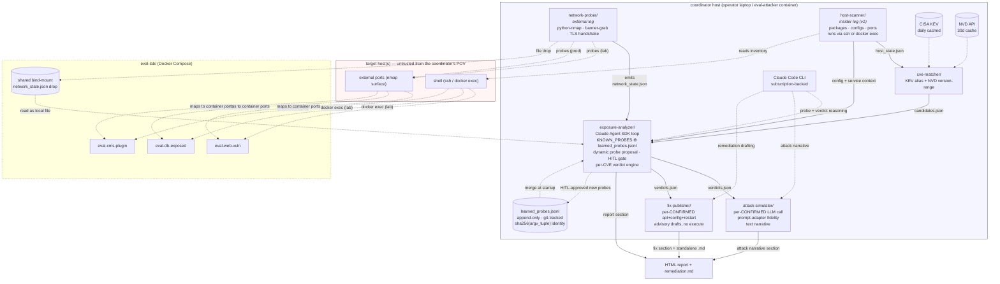
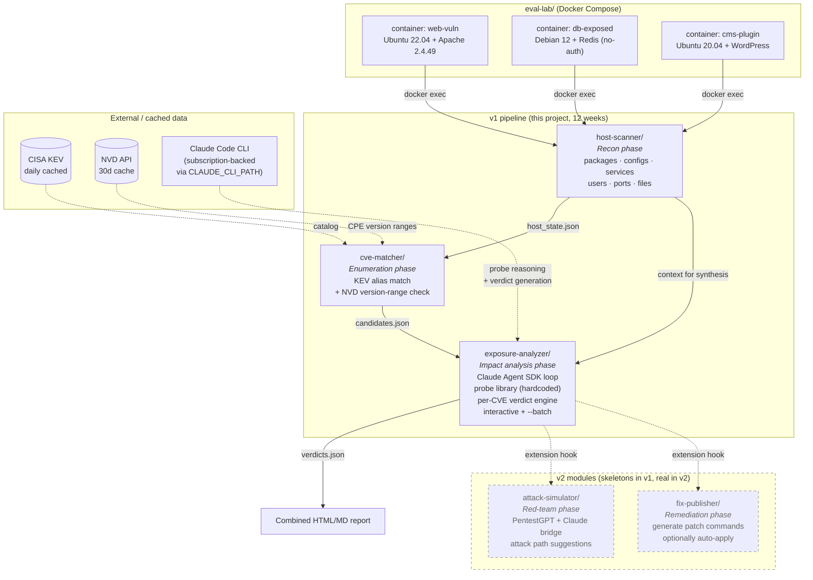

# AI-security-agent — Design & Decisions

**Project:** Cross-platform AI-augmented vulnerability assessment tool for school servers.
v1 operates from a **host-level white-box** posture (authorized privileged access on
the target); v2 extends to **gray-box** by adding an external attacker-perspective leg
and adversarial simulation. See §1 for the precise definitions used in this project.
**Level:** Undergraduate 畢業專題 (not master's thesis).
**Runway:** ~3 months (12 weeks) as of this document.
**Repo:** https://github.com/nikodacat/AI-security-agent (private).

This document captures the decisions locked in during the grill-me session and serves as the
authoritative reference for future sessions. When you come back to work on this project after
a break, read this file first — it replaces the need to re-grill.

---

## 1. Thesis claim

> An AI-augmented vulnerability assessment tool that automates the reasoning pentesters
> do between "we detected a candidate CVE" and "here's whether it actually matters on
> this host." Primary target: school servers. Secondary demo: home Windows desktop.

### 1.1 Access-model taxonomy used in this project

Precise definitions matter here because "gray-box" is used inconsistently across
industry (vulnerability scanning vs. penetration testing). This project uses the
following four-way split:

- **Black-box** — external attacker perspective only; no credentials, no internal
  visibility. Simulates an outsider with no prior access.
- **Gray-box (pentesting sense)** — insider intel + attacker perspective, cross-referenced.
  Typical example: authenticated-user testing of a web app *combined with* external
  service probing. This is what the pentesting literature (PTES, OSSTMM) means by the
  term.
- **Host-level white-box** — administrator-equivalent access on the target: package
  inventory, configuration files, running processes, filesystems. Corresponds to
  credentialed vulnerability scanning (Nessus, OpenVAS, Qualys with credentials) and
  configuration-audit tools (CIS benchmarks, Lynis, OpenSCAP). NOT application source
  review — the tool sees what the sysadmin sees, not what the developer sees.
- **White-box (source-review sense)** — full application source access, architecture
  documents, and typically the ability to instrument or rebuild the software under test.
  Out of scope for this project at both v1 and v2.

### 1.2 v1 posture: host-level white-box

v1 operates from **host-level white-box** access. Insider intel comes from the
`host-scanner` module (dpkg queries, config file reads, process lists) and from
non-destructive probes executed on the target via `docker exec` (eval-lab) or shell
(real target). External threat intel comes from the `cve-matcher` module (CISA KEV
catalog + NVD version-range checks, offline). The `exposure-analyzer` module then uses
a Claude Agent SDK loop to synthesize both streams into per-CVE verdicts without any
actual exploitation.

**What v1 deliberately lacks (the gap that keeps this from being gray-box in the
pentesting sense):** no external attacker-perspective validation. Reachability of a
port bound to `0.0.0.0`, for instance, is inferred from configuration rather than
measured from a separate vantage point. Every "exposure" verdict in v1 is a
config-inference verdict.

### 1.3 v2 posture: gray-box (planned)

v2 closes the gap by adding the external leg:

1. **`network-prober` module** — external service verification (nmap-style port scan,
   banner grab, TLS handshake) run from a separate host. Cross-references
   host-scanner's "bound to 0.0.0.0" claims with actual reachability measurements.
2. **`attack-simulator` module (PentestGPT bridge)** — adversarial reasoning layer
   that turns a v1 verdict + external reachability into an attack-path plan. Still
   advisory (no live exploitation), still with human-in-the-loop confirmation.
3. **Dynamic probe generation with allow-list + HITL** — the analyzer's probe library
   moves from strictly hardcoded (v1) to hybrid: hardcoded first, LLM-suggested
   probes only if they pass a structured-argv allow-list AND get operator approval
   before running. Generated probes that survive HITL get added to the library.
4. **`fix-publisher` module** — automated remediation drafts (patch commands,
   config diffs) for CONFIRMED findings, operator-approved before application.

The v1 → v2 transition is the shift from "authorized-insider audit" to
"insider-plus-outsider gray-box pentest." The v1 pipeline stays intact and becomes
the insider leg of the v2 gray-box workflow.

### 1.4 v2 architecture (locked 2026-09-21)

The §1.3 sketch names the four modules; this section pins down the trust
topology, data contracts, and module layout that the v2 build (see
`PROJECT_STATE.md § Roadmap → v2`) will follow. All decisions here came out of
the 2026-09-21 design-review + grill-me session and are cross-referenced from the
decisions log entry of that date.

#### 1.4.1 Trust topology — all-on-coordinator

The v2 topology has a **coordinator** and one or more **targets**, and the
coordinator holds everything sensitive:

- **On the coordinator:** Claude API key (via subscription-backed CLI), KEV/NVD
  cache, `KNOWN_PROBES`, `learned_probes.jsonl`, the analyzer loop, the
  attack-simulator and fix-publisher packages, and all report output.
- **On the target:** shell access (ssh in production; `docker exec` in
  eval-lab) and whatever external ports it already exposes. Nothing else.

This formalizes what v1 already did operationally — the analyzer never lived
on the target — and rules out target-side compromise leaking the API key or
tampering with the learned-probe log. In eval-lab the coordinator is the new
`eval-attacker` container attached to the compose network (see chunk `v2-3`);
in production the coordinator is the operator's laptop and `run_full_scan.sh
--prober-host user@host` wraps ssh+rsync to reach targets.

#### 1.4.2 Data contract — `network_state.json`

The prober's output is a **flat per-target list** rather than a nested
per-service tree. Each entry carries:

- `target` (hostname or IP), `port`, `protocol`, `reachable` (bool)
- `banner` — raw string, preserved verbatim as fallback for the analyzer prompt
- `service_guess` — parsed sub-object `{vendor, product, version}` when the
  banner-parser table can identify it; absent otherwise

Flat + JSONL-friendly so large scans stream without loading the whole file into
memory. `banner` is never dropped even when `service_guess` succeeds — the LLM
still gets to reason about the raw string. Schema + hand-crafted fixture land
in chunk `v2-2`.

#### 1.4.3 Cross-host transport — always a local file read

The analyzer never speaks a network protocol to the prober. In both
environments it reads `network_state.json` **as a local file** on the
coordinator:

- **Lab:** shared bind-mount volume in `docker-compose.yml` — the prober writes
  into the mount, the analyzer reads out.
- **Production:** the prober runs on the coordinator (or an operator-provided
  host reached via `--prober-host user@host`, wrapping ssh+rsync); the file
  ends up on the coordinator's local filesystem before the analyzer runs.

Same contract either way, no code branch on environment.

#### 1.4.4 Module layout — three new siblings, dynamic probes fold into analyzer

Three new top-level packages sit alongside `host-scanner/`, `cve-matcher/`, and
`exposure-analyzer/`:

- `network-prober/` — external-leg scanner (chunk `v2-4`).
- `attack-simulator/` — per-CONFIRMED-verdict LLM narrative generator
  (chunk `v2-9`). Prompt-adapter fidelity only; no PentestGPT code vendored,
  no tool execution.
- `fix-publisher/` — per-CONFIRMED-verdict remediation drafter
  (chunk `v2-10`). Emits an HTML section fragment for the main report **and** a
  standalone `remediation.md`. Advisory only; no auto-execute.

**Dynamic probe generation does *not* become its own package** — it folds into
`exposure-analyzer/exposure_analyzer/` (chunks `v2-7` + `v2-8`). Reason: the
HITL gate needs to run inside the analyzer's per-CVE loop and share its state
with `KNOWN_PROBES`; splitting would create a circular import between analyzer
and a probe-gen sibling.

#### 1.4.5 Dynamic probes — `learned_probes.jsonl` + `sha256(argv_tuple)` identity

`KNOWN_PROBES` stays the hand-reviewed baseline in code. Alongside it, a
`learned_probes.jsonl` **sidecar** (append-only, git-tracked) holds every
HITL-approved AI-proposed probe. At analyzer startup the sidecar merges into
the runtime probe library; the on-disk file is never rewritten, only appended
to.

- **Probe shape:** structured `{binary, args[]}`, never a shell string. The
  argv-list boundary is a hard security invariant, inherited from v1's
  `ProbeTemplate` and enforced identically for LLM-proposed probes.
- **Identity:** `sha256(argv_tuple)` — not CVE ID. Different argv against the
  same CVE re-triggers HITL. This means renaming a flag counts as a new probe
  and gets a fresh operator look.
- **HITL flags — both, deliberately awkward-named:**
  - `--auto-approve-known` — auto-approves argv-hash matches already in
    `learned_probes.jsonl`. Intended for production reruns and eval scripts;
    unseen probes still skip with `NO_EVIDENCE` verdict (they don't get
    silently approved).
  - `--auto-approve-all-unsafe` — bypasses the HITL gate entirely, including
    for probes never seen before. Experimental / testing only. The awkward
    name is intentional so eval scripts don't reach for it out of muscle
    memory.

The append-only JSONL is also a **report artifact**: chapter 5 can cite the
"evolution of the probe library" story directly from its diff.

#### 1.4.6 attack-simulator and fix-publisher — both fan out from `verdicts.json`

Neither module talks to the target and neither depends on the other. Both
consume `verdicts.json` produced by the analyzer, filter to `CONFIRMED`
entries, and make one Claude call per verdict:

- **attack-simulator** — outputs a text attack-path narrative (recon →
  discovery → exploitation), placed into the HTML report as its own section.
  No suggested attacker-tool invocations (no `nmap -sV`, no `sqlmap -u`);
  advisor-fidelity only.
- **fix-publisher** — outputs an apt-install block + config diff + service
  restart directive per CONFIRMED. Written into both an HTML section and a
  standalone `remediation.md` file that ops can hand off independently.

Because they're independent post-processing, chunks `v2-9` and `v2-10` are
fully parallelizable — the roadmap orders them for review clarity, not
dependency.

#### 1.4.7 Diagram



Source of truth for the diagram lives at `docs/diagrams/v2-architecture.mmd`.
If the architecture changes, update the `.mmd` file first, then re-paste into
this section — don't diverge them silently.

---

## 2. Decision tree (from grill-me session)

Legend: `[ASKED]` = user explicitly decided; `[AUTO]` = filled with a stable default and
accepted at final confirmation.

### Branch: Project constraints

- [ASKED] Timeline: ~3 months (12 weeks) of runway
- [ASKED] Deliverable format: written report + live demo + oral defense
- [ASKED] Primary positioning: 校園伺服器弱點評估工具; home Windows as secondary demo
- [AUTO] Project level: undergrad 畢業專題 (evaluation bar = demo-able system, not research contribution)
- [AUTO] Report language: Traditional Chinese
- [AUTO] Code + commit language: English
- [AUTO] Repo: private, `nikodacat/AI-security-agent`

### Branch: Feature scope

- [ASKED] Build the verification bridge as headline v1 feature: YES
- [ASKED] Nothing else added in v1 — cut items become v2 candidates:
  - [AUTO] Cut → v2: RPM/Fedora support
  - [AUTO] Cut → v2: external `nmap -sV` → CVE bridge
  - [AUTO] Cut → v2: additional scanner categories
  - [AUTO] Cut → v2: web dashboard polish
  - [AUTO] Cut → v2: 5-host lab (using 3-container Docker lab instead)
- [AUTO] Timing model: Claude-paced (~5-6 active weeks + 6-7 weeks buffer)
- [AUTO] Buffer usage: safety margin, not more features

### Branch: Bridge design

- [ASKED] Verifier path: A first (advisor + human-in-loop), evolve toward B (autonomous with allow-list) if time
- [ASKED] Module location: standalone sibling + top-level `run_full_scan.sh` wrapper
- [ASKED] Renames before build:
  - `home-security-ai/` → **`host-scanner/`**
  - `cve-scanner/` → **`cve-matcher/`**
  - `verifier/` (proposed) → **`exposure-analyzer/`**
- [ASKED] Probe generation: hybrid — hardcoded per-CVE for v1, Claude-generated fallback drafted as v2
- [ASKED] Demo mode: interactive default + `--batch` flag for scheduled runs
- [ASKED] Gray-box reframe adopted as the project's thesis claim
  - [AUTO] Verifier's real job = cross-domain synthesis (config + exposure + runtime → per-CVE verdict), not redundant re-scan
- [ASKED] PentestGPT usage: B + D combo now (adapt prompts + design extension hooks); Path C (full `attack-simulator/`) is v2
- [ASKED] "Fix publishment" = interpretation A — a `fix-publisher/` remediation module as v2 stretch
- [AUTO] Verifier input: JSON from cve-matcher + host-scanner output
- [AUTO] Verdict schema: `CONFIRMED` / `MITIGATED_BY_CONFIG` / `MITIGATED_BY_EXPOSURE` / `NOT_RUNNING` / `NO_EVIDENCE` + reasoning + evidence
- [AUTO] Verifier output: appended to host-scanner's existing HTML report
- [AUTO] Claude backend: Claude Code CLI (subscription-backed) via `CLAUDE_CLI_PATH`
- [AUTO] Language: Python, Claude Agent SDK loop pattern

### Branch: Evaluation plan

- [ASKED] Primary metric: TPR / FPR / coverage against ground truth; time-per-verdict secondary
- [ASKED] Numeric baseline: raw cve-matcher output (isolates analyzer's contribution)
- [ASKED] No numeric head-to-head with Nessus/OpenVAS — use a **capability comparison table** instead
- [ASKED] Value framing: v1 proves the AI-augmented reasoning layer; v2's attack-sim + fix-publisher are what pro scanners genuinely don't do
- [ASKED] Lab: Docker Compose, 3 deliberately-vulnerable containers, `ground_truth.md` committed to repo
  - [AUTO] Containers:
    - (a) Ubuntu 22.04 web (vulnerable Apache + config-mitigated OpenSSH)
    - (b) Debian 12 database (exposed Redis + old MySQL)
    - (c) Ubuntu 20.04 CMS (WordPress + vulnerable plugin)
  - [AUTO] Gray-box scanning: `docker exec` the scanner into each container
- [AUTO] Sample size: ~30 CVE evaluations across the 3 containers
- [AUTO] Randomness: single deterministic run (temperature=0); note in "threats to validity"
- [AUTO] Human-analyst baseline: OPTIONAL, only if numeric results feel thin

### Branch: Ship checklist

- [ASKED] Report length: 15-25 pages (target ~20), not 40-60
- [ASKED] Chapter structure: 緒論 / 相關研究 / 系統設計 / 實作 / 評估 / 討論與未來工作 / 結論
- [ASKED] Demo: 5-minute interactive live run in the 3-container Docker lab
- [AUTO] Advisor cadence: bi-weekly demo of latest chunk
- [AUTO] Peer testing: one friend runs `docker compose up && ./run_full_scan.sh` 1 week before defense
- [AUTO] Backup plan: pre-recorded 3-minute demo video 3 days before defense
- [AUTO] Repo visibility: private through defense day
- [AUTO] Version tag: `v1.0-defense` at the exact demoed commit
- [AUTO] Dependency caching: KEV JSON + NVD cache committed to repo day before defense

---

## 3. Architecture (v1 + v2 hooks)



Dashed boxes = v2 (skeletons only in v1 build). Solid boxes = v1 must-work by defense day.

---

## 4. v2 roadmap

v2 is under active build (locked 2026-09-21) on the `v2-dev` branch — not
post-defense any more. The authoritative sources are:

- **Architecture:** §1.4 above (trust topology, data contracts, module layout,
  dynamic probes, attack-sim + fix-publisher fan-out).
- **Chunk sequence + status:** `PROJECT_STATE.md § Roadmap → v2` (14 chunks
  `v2-1` through `v2-14`, ordered by dependency + hardest-first risk).
- **Design decisions:** `PROJECT_STATE.md § Decisions log` entry 2026-09-21.

Items still deferred beyond v2 (kept here so they're not lost):

- **RPM/Fedora inventory support** in host-scanner — v2 keeps `apt`-only.
- **Attack-simulator with real tool execution** (PentestGPT vendored, live-fire
  attack chains) — v3 direction, with the ethics/legal + kill-switch layers
  logged in the 2026-09-21 v3 forward-look entry.
- **Auto-executing fix-publisher** (rollback machinery, per-target dry-run
  matrix) — v3 stretch.
- **Web dashboard polish** — no dashboard in v2; HTML report only.

---

## 5. Report chapter allocation (~20 pages target)

| # | Chapter | Pages | Focus |
|---|---|---|---|
| 1 | 緒論 (Introduction) | 2 | motivation, professor's ask, scope |
| 2 | 相關研究 (Related Work) | 2 | Nessus/OpenVAS comparison table, PentestGPT, KEV/NVD |
| 3 | 系統設計 (System Design) | 4 | access-model taxonomy (host-level white-box → v2 gray-box), three-module architecture, diagrams |
| 4 | 實作 (Implementation) | 3 | interesting design decisions, key snippets, prompt engineering |
| 5 | 評估 (Evaluation) | 5 | lab, methodology, TPR/FPR results, capability comparison, threats to validity |
| 6 | 討論與未來工作 (Discussion & Future Work) | 2 | limitations, v2/v3 roadmap |
| 7 | 結論 (Conclusion) | 1 | wrap-up |
| — | 參考文獻 + 附錄 | 1-3 | key prompts, ground_truth.md excerpt |
| — | **Total** | **~20** | |

---

## 6. Demo script (defense day, 5 minutes)

```
0:00–0:30  Set the scene: "3-container lab representing a school server env"
           docker compose up (already running, no wait time)
0:30–1:30  Run host-scanner against container A
           Show terminal: package inventory, config extraction
1:30–2:30  Run cve-matcher on the inventory
           Show: N candidate CVEs, KEV-matched
2:30–4:00  Run exposure-analyzer INTERACTIVELY
           For 3 CVEs: show proposed probe, hit ENTER, show verdict
           Include one CONFIRMED, one MITIGATED, one NOT_RUNNING
4:00–4:30  Show the final HTML report
           "12 candidates → 3 real risks, actionable"
4:30–5:00  Show attack-simulator skeleton (v2 preview)
           "this is where the red-team module plugs in"
```

---

## 7. Next steps (immediately after this doc lands)

1. Rename `home-security-ai/` → `host-scanner/`, `cve-scanner/` → `cve-matcher/`. Update all
   imports, launchers, gitignore paths, README, LINUX.md, UPSTREAM.md, SETUP-FORKS.md.
   One commit.
2. Scaffold `exposure-analyzer/` sibling directory with package skeleton (prompts.py,
   probes.py, agent.py, report.py) — empty implementations + docstrings only.
3. Invoke `/roadmap-plan` to break the exposure-analyzer build into ordered chunks with
   explicit dependencies.
4. Kick off first chunk via `/build-verify-loop`.

---

*Document generated at the close of the grill-me session that reset this project after a
break. If a future session invalidates any of these decisions, update this file and note
what changed and why.*
